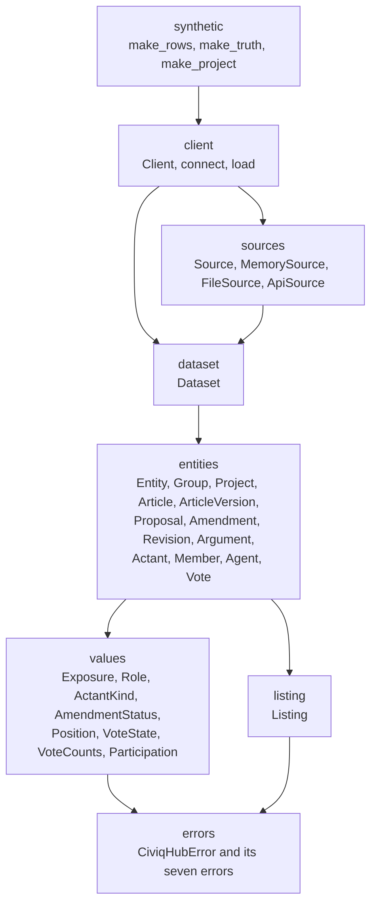
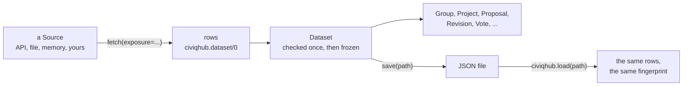

# Architecture

This page describes how the SDK is built: the rules every module follows, how the modules depend on each other, what a dataset is, and how a vote and a level of exposure are read. It is written for whoever reads the code, reviews it, or writes a source.

## Six rules

1. **A load is frozen.** A {py:class}`~civiqhub.Dataset` is everything a source gave at one instant ({py:attr}`~civiqhub.dataset.Dataset.as_of`), at one level of exposure, as one graph of frozen objects. No navigation reads the network. Loading again gives another dataset.
2. **The objects are frozen dataclasses, equal by identity in the product.** Two objects are equal when they have the same class, the same `id` and the same dataset. A link is an id; the linked object is read through a property that asks the indexes of the dataset.
3. **The core imports neither the engine nor NumPy.** `import civiqhub` loads the standard library only, and a test proves it. The analyses will live in the engine `civiqhub-selene`; the SDK holds no formula.
4. **Three states per vote.** An Actant voted on a Revision, abstained (the Revision was shown, and no vote came), or never saw it. When the data do not record what was shown, the state is unknown. An absence is never a zero nor a neutral answer.
5. **Exposure.** At the aggregated level, a dataset holds neither individual votes nor Actants; asking for them raises {py:class}`~civiqhub.ExposureError`, which says how to get the pseudonymised level. No name, e-mail address or user id of a person enters an object: an Actant is known by its pseudonym only. The token appears in no `repr`, file or source.
6. **Every analysis will cite itself.** A result of analysis will carry the result of the engine and a citation: the Project, the instant, the fingerprint of the dataset, the method, its version, its settings, the seed and the fingerprint of the computation. This rule waits for the bridge to the engine.

## Modules



| Module | Holds | Imports |
| --- | --- | --- |
| {py:mod}`civiqhub.errors` | {py:class}`~civiqhub.CiviqHubError` and its seven subclasses; each carries a {py:attr}`~civiqhub.errors.CiviqHubError.hint` | standard library |
| {py:mod}`civiqhub.values` | The closed choices of the product, {py:class}`~civiqhub.VoteCounts` and {py:class}`~civiqhub.Participation` | standard library |
| {py:mod}`civiqhub.listing` | {py:class}`~civiqhub.Listing`, the frozen list of every collection | standard library |
| {py:mod}`civiqhub.entities` | {py:class}`~civiqhub.Entity` and the objects of the product | standard library |
| {py:mod}`civiqhub.dataset` | {py:class}`~civiqhub.Dataset`, the format of the rows and its checks | standard library |
| {py:mod}`civiqhub.sources` | {py:class}`~civiqhub.Source` and the three sources of the package | standard library (`urllib` for the API) |
| {py:mod}`civiqhub.client` | {py:class}`~civiqhub.Client`, {py:func}`~civiqhub.connect`, {py:func}`~civiqhub.load` | standard library |
| {py:mod}`civiqhub.synthetic` | {py:func}`~civiqhub.make_rows`, {py:func}`~civiqhub.make_truth`, {py:func}`~civiqhub.make_project` | standard library (`random`, seeded) |

Not written yet: the bridge to the engine, `civiqhub.analysis`; the paragraphs of an article, the placement of the Proposals and the citations, whose sections a dataset keeps as they are.

## The dataset

A source gives rows: a dictionary that JSON can write, in the format {py:data}`civiqhub.dataset.FORMAT`, with one list of rows per section (`groups`, `projects`, `articles`, `article_versions`, `proposals`, `revisions`, `vote_counts`, `amendments`, `arguments`, and at the pseudonymised level `actants`, `votes`, `impressions`). A {py:class}`~civiqhub.Dataset` checks these rows once, when it is built, and gives a graph of frozen objects.



Why frozen:

- **One instant.** Every object of a dataset describes the same moment, {py:attr}`~civiqhub.dataset.Dataset.as_of`. Mixing objects read at two moments would make counts that never existed together.
- **No hidden reading.** Navigating from a Proposal to its Revisions, its Amendments or its votes reads indexes built once. It never calls the network, so it never fails halfway and never costs a request.
- **Reproducible.** {py:meth}`~civiqhub.dataset.Dataset.fingerprint` identifies the rows: the same rows give the same fingerprint on every system. {py:meth}`~civiqhub.dataset.Dataset.save` writes them to a file that reopens with the same fingerprint, so that a result can be computed again on the same data.

A rule that the rows break raises {py:class}`~civiqhub.ValidationError`, whose message names the row and the rule. To see newer data, load again: {py:meth}`Client.refresh <civiqhub.client.Client.refresh>` forgets what a client kept, and the objects already given stay valid in their own dataset.

## Three states of a vote

{py:meth}`Actant.vote_state_on <civiqhub.entities.Actant.vote_state_on>` gives a {py:class}`~civiqhub.VoteState`:

| State | When |
| --- | --- |
| `voted` | The Actant voted on the Revision |
| `abstained` | The Revision was shown to the Actant, and no vote came |
| `not_shown` | The Revision was never shown to the Actant |
| `unknown` | No vote, and the data do not record what was shown |

The data record what was shown when the rows hold the section `impressions`: {py:attr}`Dataset.has_impressions <civiqhub.dataset.Dataset.has_impressions>` says so. A vote always counts as shown.

## Levels of exposure

{py:class}`~civiqhub.Exposure` has two levels:

| Level | Holds | Who can read it |
| --- | --- | --- |
| `aggregated` | The vote counts of each Revision and the participation of the Project; no Actant, no individual vote | Any token of the Project; the default of {py:func}`~civiqhub.connect` |
| `pseudonymised` | One row per vote, each Actant known by a pseudonym; the authors of Proposals and Arguments | A token of a Project whose administrator enabled it |

Data never gain detail: rows held at the aggregated level cannot be served at the pseudonymised level. Pseudonymised rows asked for at the aggregated level lose their individual sections and their authors, and keep the vote counts. {py:func}`civiqhub.sources.at_exposure` does both, for every source.

## Sources

A source is the port through which data enter the SDK. It has one duty: {py:meth}`Source.fetch <civiqhub.sources.Source.fetch>` gives rows in the format of a dataset, at the level asked for. {py:meth}`Source.describe <civiqhub.sources.Source.describe>` says where they come from, never with a secret; the dataset shows it as its source.

| Source | Reads |
| --- | --- |
| {py:class}`~civiqhub.ApiSource` | The CiviqHub API, with a personal access token. Provisional: the API is not published, and its paths are assumptions kept in {py:attr}`ApiSource.PATHS <civiqhub.sources.ApiSource.PATHS>` |
| {py:class}`~civiqhub.FileSource` | A file written by {py:meth}`~civiqhub.dataset.Dataset.save` |
| {py:class}`~civiqhub.MemorySource` | Rows held in memory: tests, simulations, the data of another system |

A source of your own derives from {py:class}`~civiqhub.Source` and works with every client, without a change in the package:

```python
from typing import Any

import civiqhub
from civiqhub.sources import at_exposure


class SpreadsheetSource(civiqhub.Source):
    name = "spreadsheet"

    def __init__(self, rows: dict[str, Any]) -> None:
        self.rows = rows

    def fetch(self, container=None, *, exposure):
        return at_exposure(self.rows, exposure)

    def describe(self) -> str:
        return "spreadsheet budget.ods"


source = SpreadsheetSource(civiqhub.make_rows())
project = civiqhub.connect(source=source).project()
print(project.dataset.source, project.dataset.exposure)
```

```text
spreadsheet budget.ods aggregated
```

## Tests

| File | Checks |
| --- | --- |
| `tests/test_guarantees.py` | The promises of this page: the core loads the standard library only, the token leaks nowhere, no personal data enters an object, no module computes a statistic |
| `tests/test_api_source.py` | The API source against a fake API, without network |
| `tests/test_snippets.py` | The snippets of the README and of [Snippets](snippets.md), against the fake API |
| `tests/test_docs_examples.py` | Every other Python block of these pages, and the output it prints |
| `tests/test_docs_reference.py` | Every public module has a page in the reference |

## Words

| Word | Meaning |
| --- | --- |
| dataset | Everything a source gave at one instant, frozen |
| actant | Whoever acts in a Project: a human member or an agent, known by a pseudonym only |
| vote counts | The five counts of the votes of a Revision, from score -2 to score +2 |
| exposure | The level of detail served: aggregated or pseudonymised |
| impression | The fact that a Revision was shown to an Actant |
| vote state | Where an Actant stands on a Revision: voted, abstained, not shown or unknown |
| fingerprint | 16 hexadecimal characters of a SHA-256 of the rows; the same rows give the same fingerprint |
